# 🕹️ ArcadeMania — 10,000 Games in 1

A **.NET 10 MAUI** game collection: **arcade, simulation and fighting** games in one app. It renders vectors at
**native 4K (3840×2160)**, needs no login, and supports **Xbox and PlayStation controllers**, keyboard and touch.

**Flow:** `PLAY` → **Categories** (Arcade · Simulation · Fighting · All) → **pick a game** → play.

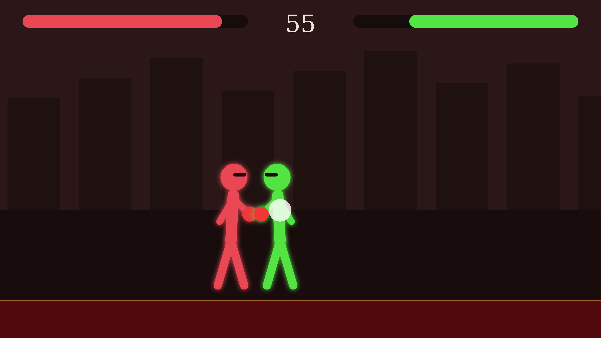

> All screenshots are real 3840×2160 frames from the game engine, rendered by `tools/ArcadeMania.Shots`.

---

## What's inside

There are 12 hand-built game engines. Each one has 833–834 variants that are generated deterministically (seeded), for a total of **10,000 games**.
A variant changes speed (0.75×–1.65×), difficulty (1–10), the rule mode (walls, layouts, crops, rule sets, fighter
styles) and the colour palette. Game numbers (#00001–#10000) are stable, so a best score always belongs to the same game.

| Category | Game | What changes per variant |
|---|---|---|
| Arcade | 🐍 **Snake** | wall wrap vs solid, speed |
| Arcade | 🧱 **Brick Breaker** | layouts (grid / checker / pyramid), levels, speed |
| Arcade | 🚀 **Star Shooter** | single / triple shot, enemy fire rate, waves |
| Arcade | 🏓 **Paddle Duel** | CPU skill, ball speed |
| Arcade | 🐦 **Sky Hopper** | gap size, scroll speed |
| Arcade | 🟪 **Block Drop** | gravity, colour sets |
| Simulation | 🧬 **Life Lab** | 8 cellular-automata rule sets (Conway, HighLife, Day & Night, Maze, Coral…) |
| Simulation | 🌙 **Lunar Lander** | gravity, pad size, terrain |
| Simulation | 🌾 **Tiny Farm** | crop (wheat / carrot / tomato / pumpkin), prices, land cost, day/night + rain |
| Simulation | 🦊 **Eco System** | predator count, metabolism — keep rabbits & foxes alive |
| Fighting | 🥊 **Street Brawl** | Brawler / Karate / Boxer / Ninja, CPU aggression |
| Fighting | ⚔️ **Blade Duel** | Swordsman / Spearman / Samurai / Knight, reach & power |

| | | |
|---|---|---|
| 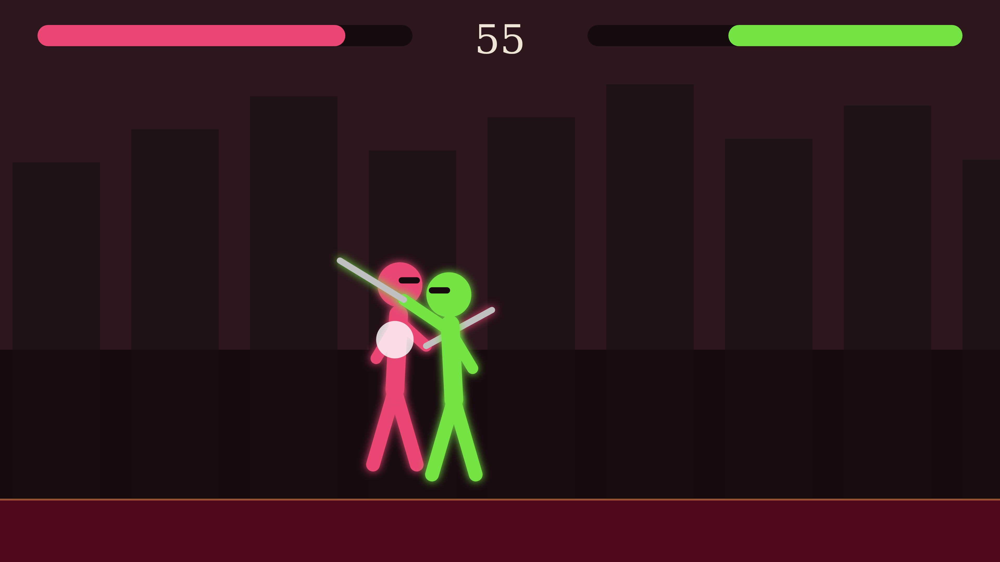 | 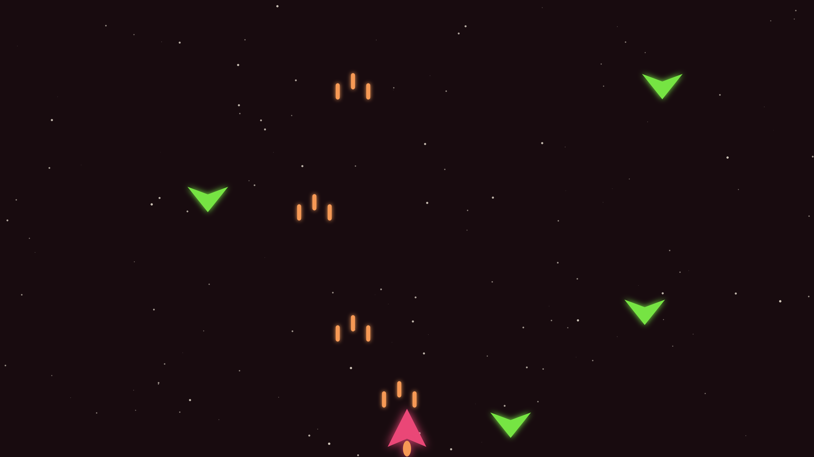 | 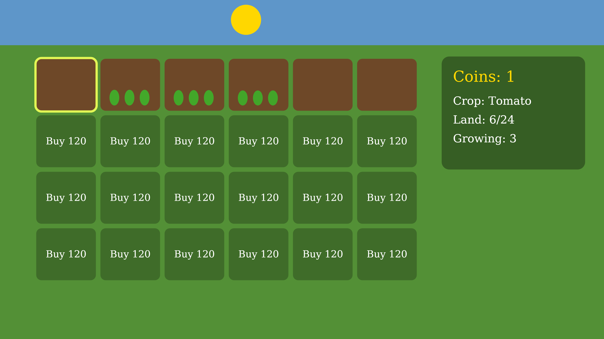 |
| 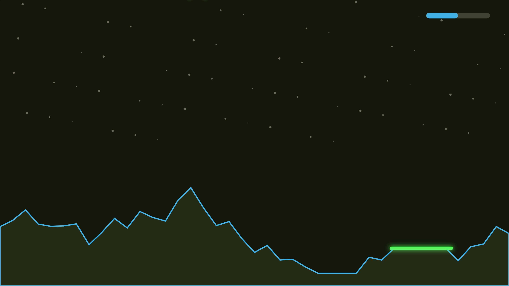 | 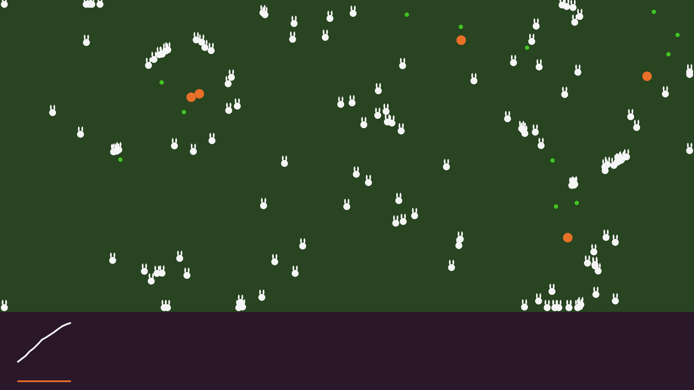 | 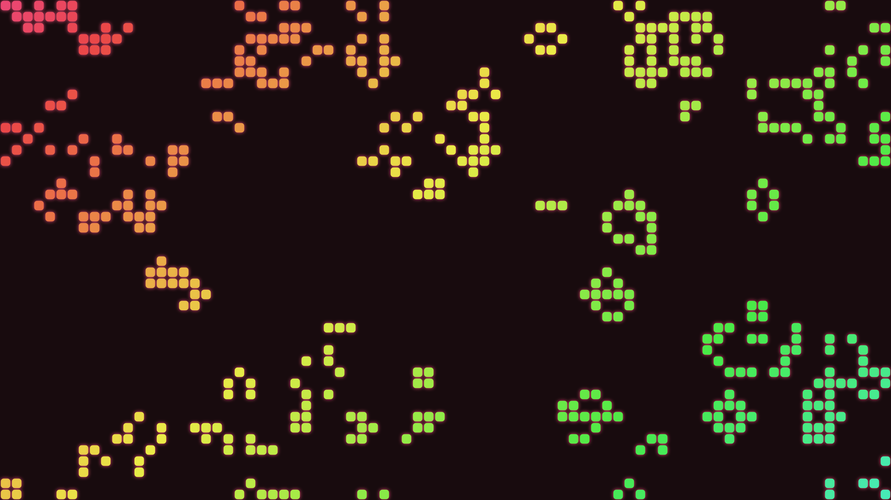 |
| 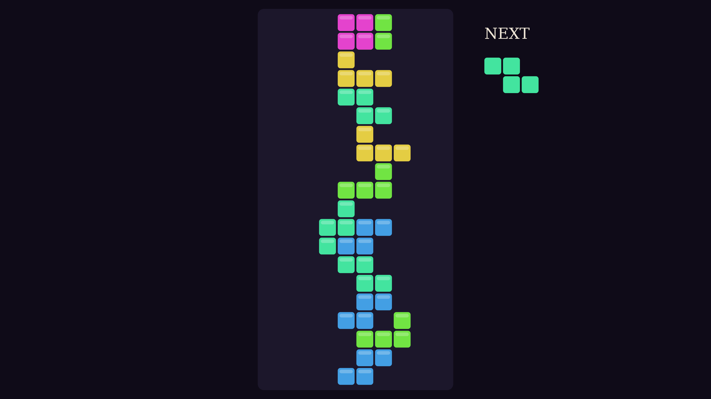 | 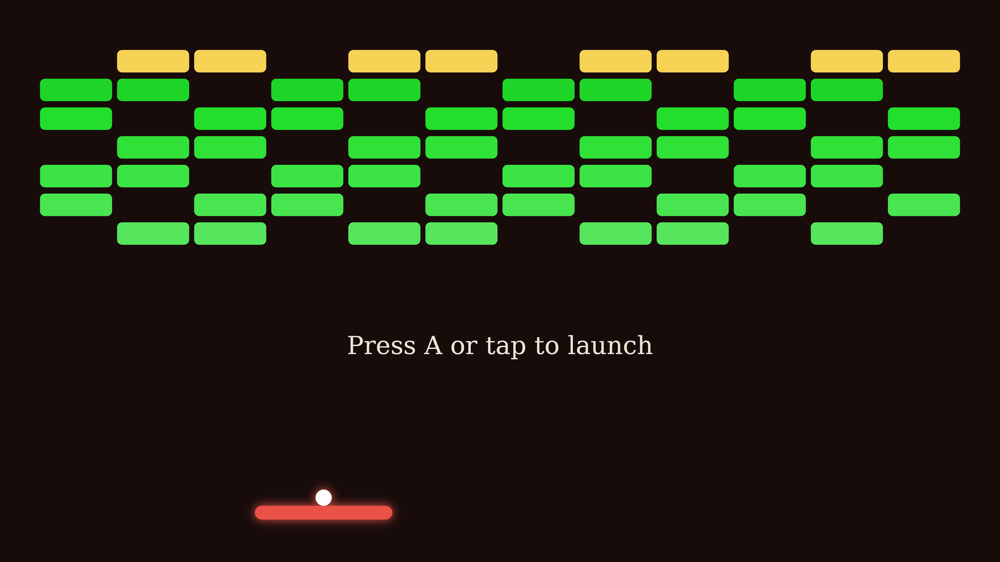 | 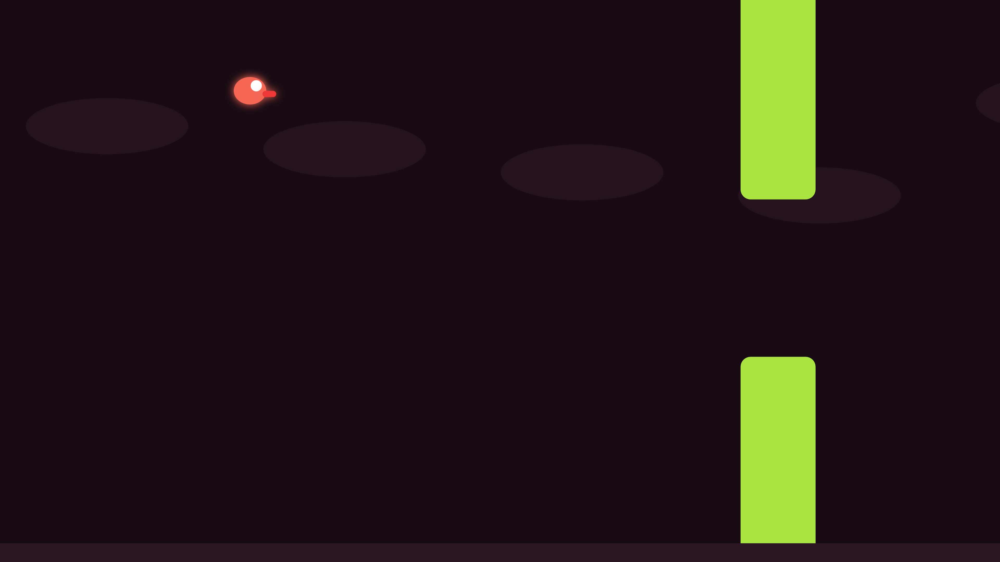 |
| 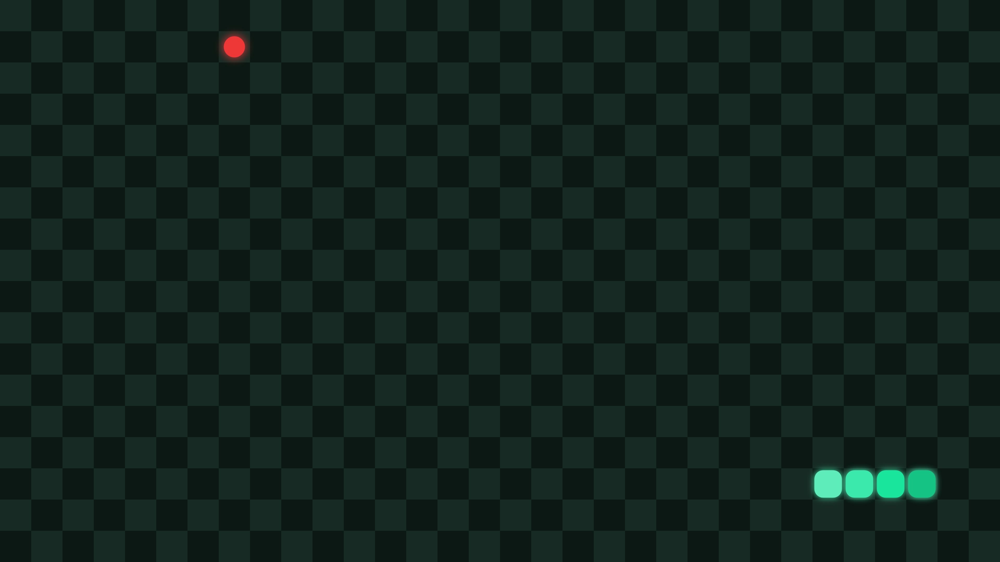 | 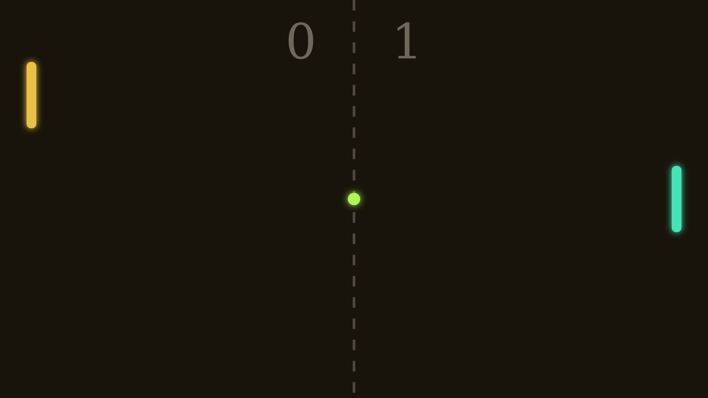 | |

## 4K rendering

Every game draws into a fixed 1600×900 world using `Microsoft.Maui.Graphics` vector commands. `GameDrawable` scales
that world to the **native pixel grid** of the display, letterboxing as needed. On a 4K monitor or TV the frame is rasterised
at 3840×2160, not upscaled, and the same holds for 1440p, 8K and phone screens.
The in-game HUD shows the live render resolution and FPS. On Windows the app starts maximised; **⛶** or **F11** toggles
borderless full screen.

## Controllers & consoles

| Action | Xbox | PlayStation (DS4 / DualSense) | Keyboard | Touch |
|---|---|---|---|---|
| Move / menu navigate | D-pad / Left stick | D-pad / Left stick | Arrows / WASD | on-screen D-pad |
| A — confirm, jump, fire, light attack | **A** (or X, RB) | **✕** (or □, R1) | Z / J / Space | **A** |
| B — back in menus, heavy attack / rotate in game | **B** (or Y, LB) | **○** (or △, L1) | X / K | **B** |
| Pause | Menu | Options | Enter / P | ⏸ |
| Back to previous screen | View | Share / Create | Esc | ◀ Back |

* **Windows:** Xbox pads via `Windows.Gaming.Input.Gamepad`; PlayStation and other HID pads via `RawGameController`.
* **Android phones, tablets & Android TV:** any Bluetooth/USB controller through `KeyEvent` / `MotionEvent`. The app
  shows up in the Android TV launcher (leanback) and doesn't require a touchscreen.
* **Running on an Xbox or PS5 console itself:** .NET MAUI has no console targets. Xbox needs a UWP or GDK build through the
  Xbox Creators / ID@Xbox programme. PS5 needs Sony's licensed SDK, which is only available to approved developers. The
  `ArcadeMania.Core` engine is plain .NET with no MAUI dependency, so it can be hosted by a console front end later. The
  game code doesn't need to change.

## Screens

* **Play:** start screen with PLAY, Random game, and the Day/Night theme toggle. There's no login.
* **Categories:** four tiles that list the engines in each category and how many games it holds.
* **Game list:** a virtualised grid of up to 10,000 games. Search by name or `#number`, filter by game type, see your best score. It uses 1 to 6
  columns depending on screen width.
* **Game:** the game canvas, score, pause, restart, full screen, touch pad on phones and tablets, and a game-over panel
  (play again / next game / random / back).

Every screen has **Back**, **Home** and **Exit**. The phone/controller Back button always returns to the previous screen and never
closes the app. On the start screen it asks before exiting, and screens never close by themselves. Every clickable item shows the
**hand cursor** on hover (Windows). The theme is **Warm Linen** (Day = Cool Mist, Night = Warm Ember) with Cormorant Garamond + DM Sans.

## Security

| Area | Implementation |
|---|---|
| **Encryption (military-grade)** | **AES-256-GCM** authenticated encryption (`AesGcmCrypto`): random 96-bit nonce per write, 128-bit tag, tamper-evident. |
| Saves & best scores | Stored only on the device, encrypted at rest in `saves/save.dat`, written atomically. A corrupt or tampered file is discarded safely and never crashes the app. |
| Key storage | A 256-bit per-install key in the **OS keystore** through MAUI `SecureStorage` (Android Keystore, Windows DPAPI, iOS Keychain). The key never sits in the repo or a plain file. |
| Config secrets | `ConfigProtector`: `enc:` values are AES-256-GCM ciphertext. The key comes from the `ARCADEMANIA_MASTER_KEY` environment variable (base64, 32 bytes) and is never committed. Plain values still work in dev. |
| **DLL locks** | Release: IL trimming and **R8 shrinking/obfuscation** (Android), APK/AAB **signing**, Authenticode signing for the Windows exe, and a **startup integrity check**. `tools/integrity/gen-integrity.ps1` writes SHA-256 hashes of every shipped DLL/EXE. If any file is modified, the app shows a message and **exits cleanly**. It never deletes or corrupts files. |
| Bot / macro protection | `BotGuard` throttles input floods with a token-bucket `RateLimiter` (30 presses/s) and ignores machine-perfect rapid-fire timing. |
| Crash safety | Global exception handlers (AppDomain, TaskScheduler, Android). Each frame's update/draw is isolated, and a faulting game restarts itself without taking down the app. |
| Privacy | Fully offline. There's no INTERNET permission on Android, no accounts, no analytics. |

## Architecture

```
src/ArcadeMania.Core      Pure .NET 10 engine (no UI dependency)
  Engine/                 GameBase, InputState, VariantSpec, Palette, GamepadMapper
  Games/                  12 engines (Arcade1/2, Simulation, Fighting)
  Catalog/                GameCatalog — 10,000 entries, search, filters (lazy, cached)
  Security/               AES-256-GCM, ConfigProtector, EncryptedSaveStore, ScoreCache, RateLimiter, BotGuard, IntegrityVerifier
src/ArcadeMania.App       .NET MAUI app (Android, Windows; iOS/Mac on macOS)
  Pages/                  PlayPage → CategoriesPage → GameListPage → GamePage (+ BasePage: Back/Home/Exit, controller focus)
  Services/               ControllerHub (all input devices), Theme, AppServices, PlatformHelpers
  Platforms/Windows       Gamepad poller (Xbox + PlayStation), keyboard, full screen, hand cursor
  Platforms/Android       Controller key/axis dispatch, Android TV launcher
tests/ArcadeMania.Tests   110 xUnit tests: startup/crash, every engine fuzzed for 30 s of play, security, controllers
tools/ArcadeMania.Shots   Renders the 4K screenshots
```

**Design notes.** ArcadeMania is a single-player, fully offline client, so there's no server to load-balance or shard. The
system-design ideas that apply to a client are used: **caching** (catalog built once; best scores held in memory with write-through),
**rate limiting**, bot protection, **idempotent** atomic save writes, and a **circuit-breaker-style** recovery for a faulting game. If online
leaderboards are added later, they belong in a separate ASP.NET Core service behind a load balancer, with Redis caching and
sharded score tables. Local encrypted storage stays the default, and Azure Blob storage would only be an optional switch.

## Build & run

Requirements: .NET 10 SDK and the MAUI workload (`dotnet workload install maui`).

```bash
# Tests (any OS)
dotnet test tests/ArcadeMania.Tests

# Android APK / AAB
dotnet publish src/ArcadeMania.App -f net10.0-android -c Release

# Windows .exe (run on Windows)
dotnet publish src/ArcadeMania.App -f net10.0-windows10.0.19041.0 -c Release -o publish/win
pwsh tools/integrity/gen-integrity.ps1 -PublishDir publish/win

# Regenerate 4K screenshots
dotnet run --project tools/ArcadeMania.Shots -- docs/screenshots 3840 2160
```

### Docker
The Dockerfile builds the engine, runs the full test suite and renders the screenshots in a clean container (CI):
```bash
docker build -t arcademania-ci .
docker build --target screenshots -o out .
```

## Tests

`dotnet test` runs **110 tests**: catalog integrity (exactly 10,000 unique games), launch tests for every engine plus
extreme variants (30 simulated seconds of random input, drawing, restarting), resume-after-background frame spikes, AES-256-GCM
round trips and tamper detection, encrypted saves surviving corruption, rate limiter, bot guard, integrity verifier, and Xbox and
PlayStation button mapping.

## Changelog

* **1.0.0 (2026-11-14):** first release. 12 engines and 10,000 games, 4K vector renderer, Xbox and PlayStation controller support,
  Android TV support, Warm Linen Day/Night theme, AES-256-GCM encrypted saves, anti-tamper check, 110 tests.

## License

**Proprietary.** Copyright (c) 2026 Rakesh Kumar <rakkarajput@gmail.com>. All rights reserved. No rights are granted without
written permission. Third-party components keep their own licences. See [LICENSE](LICENSE).
